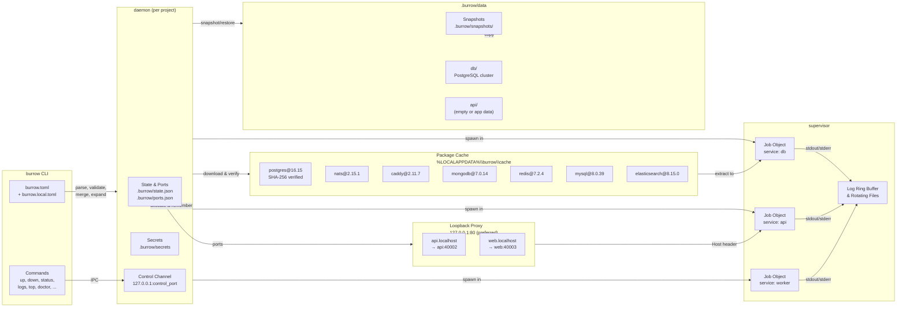

# Burrow

<div align="center">
  
</div>

**Native Windows local development stacks. One `burrow.toml`. Stable ports. Health-gated startup. Logs, snapshots, and a live dashboard. No Docker daemon or VM by default.**

---

## Quick Install

```powershell
# winget (Windows Package Manager)
winget install vanshcodeworks.Burrow

# Scoop
scoop install burrow

# Chocolatey (pending review)
choco install burrow

# Cargo (from source)
cargo install --path crates\burrow-cli --locked

# Manual: download burrow-v0.1.0-windows-x86_64.zip from GitHub Releases
```

---

## What Is This? (In Plain English)

**Burrow is a tool that starts your whole local dev stack with one command.**

You write a `burrow.toml` file listing your services (e.g., PostgreSQL database, Node.js API, background worker). Then you run:

```
burrow up
```

Burrow:
1. **Downloads** the exact PostgreSQL version you need (verified SHA-256) into a local cache
2. **Starts** each service as a real Windows process — no Docker, no VM
3. **Waits** until each service is actually healthy before starting the next one
4. **Gives you** stable URLs like `http://api.localhost` that work every time
5. **Shows** a live dashboard (`burrow top`) with logs, CPU, and memory

When you're done:
```
burrow down
```

Everything stops cleanly. Your data stays in `.burrow/data/` — you can snapshot it, restore it, or reset a single service.

**Why not Docker Compose?**
- Docker runs a Linux VM on Windows (slow, heavy, licensing)
- Burrow runs native Windows binaries directly — faster startup, less memory, no VM
- Use `use = "container:IMAGE"` only for services that don't have a Windows build

---

## Quick Start (Real-Life Steps)

**Prerequisites:**
- Windows 11 (verified). Windows 10 works but unverified.
- A normal terminal — **not Administrator**. PostgreSQL refuses to initialize as admin.
- Node.js, Python, Go, Rust, etc. already on your PATH (Burrow doesn't install languages).
- To build from source: Rust 1.85+ and Visual Studio Build Tools.

**Quick install (pick one):**

```powershell
# winget (Windows Package Manager)
winget install vanshcodeworks.Burrow

# Scoop
scoop install burrow

# Chocolatey (pending review)
choco install burrow

# Cargo (from source)
cargo install --path crates\burrow-cli --locked
```

**Try the example project:**

```powershell
# 1. Get the code
git clone https://github.com/vanshcodeworks/burrow.git
cd burrow

# 2. Install Burrow (any method above, or build from source)
cargo install --path crates\burrow-cli --locked

# 3. Run the example project
cd examples\node-postgres
npm install
burrow up
```

**What happens:**
1. First run: downloads PostgreSQL (~356 MB), initializes the database, seeds it, starts the API
2. Later runs: **~1.87 seconds** — uses cached PostgreSQL and initialized database
3. Open `http://api.localhost` in your browser — it just works
4. Press `Ctrl+C` or run `burrow down` to stop

**Python example (FastAPI + PostgreSQL):**
```powershell
cd examples\python-postgres
python -m venv .venv
.\.venv\Scripts\Activate.ps1
pip install -r requirements.txt
burrow up
```

---

## Quick Navigation

## Quick Navigation

| Section | Description |
|---------|-------------|
| [Quick Start](#quick-start) | One-command demo with `burrow up` |
| [What Is Burrow](#what-is-burrow) | Purpose and design philosophy |
| [Why Burrow Exists](#why-burrow-exists) | The problem it solves |
| [Configuration Example](#configuration-example) | Real `burrow.toml` showcase |
| [Features as Product Benefits](#features-as-product-benefits) | What you get |
| [Architecture](#architecture) | Mermaid diagram of the system |
| [How Orchestration Works](#how-orchestration-works) | Startup, health, dependency graph |
| [Native Process Management](#native-process-management) | Job Objects, limits, cleanup |
| [Networking & Stable Ports](#networking--stable-ports) | Per-project ports, loopback proxy |
| [Package Registry & Cache](#package-registry--cache) | Verified downloads, content-addressed cache |
| [Diagnostics & Live Dashboard](#diagnostics--live-dashboard) | `doctor`, `top`, diagnostic bundles |
| [Snapshots & Restore](#snapshots--restore) | Full-directory copies, journaled rollback |
| [Measured Benchmarks](#measured-benchmarks) | Real numbers from `docs/benchmarks.md` |
| [Fair Tool Comparison](#fair-tool-comparison) | Where Burrow fits vs alternatives |
| [CLI Command Reference](#cli-command-reference) | Every command and flag |
| [Platform Compatibility](#platform-compatibility) | Verified and unverified environments |
| [Security & Trust](#security--trust) | Trust model, secrets, non-sandbox warning |
| [Limitations & Non-Goals](#limitations--non-goals) | Honest boundaries |
| [Documentation Index](#documentation-index) | All docs with links |
| [Development Setup](#development-setup) | Build, test, CI |
| [Contributing](#contributing) | How to help |
| [License](#license) | MIT OR Apache-2.0 |

---

## Quick Start

**Requirements:**
- Windows 11 x86-64 (verified). Windows 10 intended but unverified.
- A normal, non-elevated terminal. PostgreSQL refuses to initialize under an administrator token.
- The runtimes your services need (`node`, `npm`, `python`, `cargo`, `go`, ...) on `PATH`. Burrow does not install language runtimes.
- To build from source: Rust 1.85+ and MSVC build tools with Windows SDK.

**One-command demonstration:**

```powershell
git clone https://github.com/vanshcodeworks/burrow.git
cd burrow
cargo install --path crates\burrow-cli --locked

cd examples\node-postgres
npm install
burrow up
```

The first `burrow up` shows a trust summary, downloads the verified PostgreSQL archive (356 MB), initializes the cluster, seeds it, and starts both services. Later starts that reuse the package cache and initialized cluster take **~1.87 s** on the benchmark machine.

Open `http://api.localhost` or the direct loopback URL from `burrow status`. Press `Ctrl+C` or run `burrow down` to stop.

For the Python FastAPI example, activate a virtual environment first because managed services inherit the daemon's environment:

```powershell
cd examples\python-postgres
python -m venv .venv
.\.venv\Scripts\Activate.ps1
python -m pip install -r requirements.txt
burrow up
```

See [Getting Started](docs/getting-started.md) for the full walkthrough, including what to do when `api.localhost` does not resolve.

---

## What Can Burrow Run?

### Native Windows Services (built-in or custom registry)

| Category | Examples |
|----------|----------|
| **Databases** | PostgreSQL, MySQL, MongoDB, Redis, Elasticsearch, SQLite |
| **Message Queues** | NATS, Redis (pub/sub), RabbitMQ (if Windows build exists) |
| **Web Servers** | Caddy, nginx, Apache (if Windows builds exist) |
| **App Runtimes** | Node.js, Python, Go, Rust, .NET, Java, PHP, Ruby, Bun, Deno |
| **Custom** | Any Windows executable with CLI args |

### Via Container Fallback (`use = "container:IMAGE"`)

Any Docker image (PostgreSQL, MongoDB, Redis, Kafka, Kafka Connect, etc.). Requires Docker Desktop or Podman. Ephemeral filesystem (snapshots don't cover container internals).

### Example Full Stack

```toml
[project]
name = "myapp"

[packages]
postgres = { version = "16", source = "builtin" }
redis = { version = "7", source = "builtin" }
mongodb = { version = "7", source = "builtin" }

[services.db]
use = "postgres@16"
memory = "512MB"
seed = "db/init.sql"

[services.cache]
use = "redis@7"
memory = "128MB"

[services.search]
use = "mongodb@7"
memory = "256MB"

[services.api]
run = "node server.js"
needs = ["db", "cache"]
env = { DATABASE_URL = "{{db.url}}", REDIS_URL = "{{cache.url}}" }
health = { http = "/health", timeout = "60s" }
route = "api.localhost"

[services.worker]
run = "go run ./cmd/worker"
needs = ["db", "search"]
```

---

## What Is Burrow

Burrow is a **Windows-native process manager for local development stacks**. It reads one `burrow.toml`, validates it strictly, and starts each service as a native Windows child process inside a Windows Job Object.

| Built for | Not built for |
|-----------|---------------|
| Windows 11 x86-64 local development | Production, shared, or multi-tenant environments |
| Native services with trustworthy Windows builds | Linux-only binaries, Linux containers, or image-based workflows |
| One `burrow.toml` per project | Replacing Docker Compose feature-for-feature |
| Stable ports, health checks, logs, snapshots | Sandboxing or isolating untrusted code |
| Solo developers and small teams | A GUI, cloud control plane, telemetry, or auto-updater |

**Status:** v0.1.0 released. Windows 11 x64 is the verified platform. Windows 10, ARM64, true standard-user accounts, OneDrive/UNC paths, FAT/exFAT volumes, corporate antivirus, `LongPathsEnabled=0`, and 8.3-disabled volumes are unverified. See the [compatibility matrix](docs/compatibility.md).

**Installers:** winget (`winget install vanshcodeworks.Burrow`), Scoop (`scoop install burrow`), Chocolatey (draft, pending review), MSI (source ready). The supported install path is `cargo install --path crates\burrow-cli --locked` from a source checkout; winget and Scoop are published with real SHA256 hashes.

---

## Why Burrow Exists

Developers on Windows who want to run a PostgreSQL database, a Node.js API, and maybe a worker face a choice:

- **Docker Desktop + Compose** — pulls a Linux VM/WSL 2 backend, image builds, dynamic ports, 37–62 MB container memory (excluding the VM), licensing terms for larger orgs.
- **Manual process management** — `start /b` in multiple terminals, no health gating, no stable ports, no logs, no snapshots.
- **Process Compose / Overmind** — cross-platform process orchestration, but no Windows package registry, no loopback proxy, no generated environments/secrets, no snapshots.

Burrow exists to give Windows developers a **single, native tool** that:
- Downloads and verifies pinned native packages (PostgreSQL, MongoDB, Redis, NATS, Caddy, MySQL, Elasticsearch) with SHA-256
- Allocates stable per-project ports (40000–49999) that survive restarts
- Health-gates service startup via dependency graph
- Generates environments and per-service secrets automatically
- Provides a loopback reverse proxy with `*.localhost` routes and WebSocket passthrough
- Captures logs in a ring buffer and rotating files
- Shows a live terminal dashboard (`burrow top`)
- Snapshots full service data directories with journaled restore
- Runs a read-only diagnostic suite (`burrow doctor`) with remedies
- All without a Docker daemon, VM, or container runtime for native services

---

## Configuration Example

A complete, runnable `burrow.toml` from `examples/node-postgres`:

```toml
# Node.js API + PostgreSQL
# Install dependencies once with `npm install`, then run `burrow up`.
# The database is downloaded into Burrow's shared cache on first start.

[project]
name = "node-postgres"

[services.db]
use = "postgres@16"
memory = "256MB"
seed = "db/seed.sql"

[services.api]
run = "node server.js"
needs = ["db"]
env = { DATABASE_URL = "{{db.url}}", PORT = "{{api.port}}" }
health = { http = "/health", timeout = "120s", interval = "300ms" }
restart = "on-failure"
route = "api.localhost"
```

**Key points demonstrated:**
- `use = "postgres@16"` pulls the newest 16.x from the built-in registry (pinned URL, size, SHA-256)
- `seed` runs `db/seed.sql` once after the first successful health check
- `needs = ["db"]` makes the API wait for PostgreSQL to be healthy
- Template variables `{{db.url}}` and `{{api.port}}` expand to resolved values
- `health.http` gates dependent startup; `restart = "on-failure"` enables exponential backoff with crash-loop breaker
- `route = "api.localhost"` enables `http://api.localhost` through the loopback proxy

See the [Configuration Reference](docs/config-reference.md) for every field, default, and validation rule.

---

## Features as Product Benefits

| Capability | What it does for you |
|------------|----------------------|
| **One config** | `burrow.toml` with strict validation, local overrides (`burrow.local.toml`), template expansion, dependency graphs, cycle reports, generated per-project secrets, and a checked JSON Schema (`burrow schema`). |
| **Native supervision** | Every service runs in a Windows Job Object with memory/CPU limits, health-gated startup, restart backoff (500 ms → 30 s), crash-loop breaker (5 failures/60 s), graceful shutdown (`CTRL_BREAK` → `TerminateJobObject`), and per-service rotating logs. |
| **Verified packages** | Content-addressed cache with pinned URL, byte size, SHA-256, resumable downloads, hardened extraction (rejects absolute paths, `..`, symlinks, reserved names), and one-time database initialization/seeding. |
| **Stable networking** | Per-project ports (40000–49999, remembered in `.burrow/ports.json`), a `*.localhost` reverse proxy with WebSocket passthrough, and `open`, `env`, `exec` helpers. |
| **Scaffolding** | `burrow init` detects Node (Vite/Next/Express), Python (FastAPI/Flask), Cargo, Go, and PostgreSQL projects; named templates for explicit choice. |
| **Diagnostics** | Read-only `burrow doctor` with a remedy for every failure and JSON output; `burrow top` live dashboard; redacted diagnostic bundles (`doctor --report`). |
| **Data safety** | Full-directory snapshots (`burrow snapshot`), restore with rollback (`burrow restore`), listing (`burrow snapshots`), and per-service reset (`burrow reset`). |
| **Opt-in containers** | `use = "container:IMAGE"` delegates to Docker or Podman when no trustworthy native build exists; loopback-only port mapping, ephemeral filesystem. |

---

## Architecture



**Single animated architecture diagram** at [`docs/assets/burrow-architecture.svg`](docs/assets/burrow-architecture.svg) in the Furrow palette.

---

## How Orchestration Works

### Startup sequence

1. **Load & validate** — CLI reads `burrow.toml` (+ `burrow.local.toml`), validates strictly (unknown keys = error), expands templates, builds dependency graph.
2. **Trust approval** — First run prints every command and download, requires `y`/`yes`. Approval hashed by project name + service names + `use`/`run`/`cwd`. Stored in `.burrow/trust.json`. `--yes` for CI.
3. **Daemon start** — `burrow up --detach` launches background daemon; foreground mode streams logs and stops on `Ctrl+C`.
4. **Package warm** — For each `use` service, download (resumable), verify SHA-256, extract to content-addressed cache. Registry entries are compiled into `burrow.exe`.
5. **Layered startup** — Services start in topological layers. All services in a layer start in parallel; next layer waits for **every** health check in the previous layer to pass.
6. **Health gating** — Three check types: `http` (GET, any <500 = healthy), `tcp` (connect), `cmd` (exit 0). Configurable timeout, interval, retries. Package can advertise default; service-level overrides.
7. **Proxy up** — Reverse proxy starts on port 80 (fallback to stable random), binds `127.0.0.1` by default. Routes match `Host` header; WebSocket upgrades tunnelled.
8. **Ready** — All services `healthy` → daemon marks `ready: true` in state; CLI prints service list with URLs.

### Dependency graph

- `needs` declares explicit dependencies; unknown names and cycles are configuration errors.
- `burrow up api` starts `api` + transitive `needs` only.
- Services without a `health` block are ready when their process starts.

### Restart & crash-loop breaker

- `restart = "on-failure"` (default) or `"always"` — exponential backoff 500 ms → 30 s.
- 5 failures within 60 s → service becomes `failed`, stops retrying, reported in `burrow status`.
- A run lasting ≥30 s resets the failure counter. `burrow restart` also resets it.

---

## Native Process Management

### Windows Job Objects (one per service)

- Created with `CreateJobObjectW`, configured with `JOBOBJECT_EXTENDED_LIMIT_INFORMATION`:
  - `JOB_OBJECT_LIMIT_KILL_ON_JOB_CLOSE` — Windows terminates all processes in the job when the last handle closes (including on daemon crash).
  - Per-process memory limit (`ProcessMemoryLimit`) and job-wide limit (`JobMemoryLimit`).
  - Optional CPU rate control (`JOB_OBJECT_LIMIT_CPU_RATE_CONTROL`) for hard CPU caps.
- Child assigned at **creation time** via `STARTUPINFOEX` + `PROC_THREAD_ATTRIBUTE_JOB_LIST` — no race where descendants escape before `AssignProcessToJobObject`.
- `CREATE_NEW_PROCESS_GROUP` enables targeted `CTRL_BREAK_EVENT` delivery.

### Resource limits are operational safeguards, not a security boundary

> **Services run as your Windows user with the same filesystem and network access you have.** Job Objects contain accidental resource use and ensure cleanup. They do **not** isolate services from each other or from your account. Do not run untrusted code with Burrow.

### Shutdown sequence

1. `GenerateConsoleCtrlEvent(CTRL_BREAK_EVENT, pid)` to the service's process group.
2. Wait configured `grace` (default `10s`) for clean exit.
3. If still alive, `TerminateJobObject`.
4. Wait until job empty, close job handle.

### Log forwarding

- Child stdout/stderr redirected through pipes.
- Tokio reader tasks drain continuously, forward complete lines to per-service ring buffer, append to rotating files under `.burrow/logs/`.
- Full pipe buffer cannot block the child.

---

## Networking & Stable Ports

### Port allocation

- Automatic ports chosen from **40000–49999**, probed on `127.0.0.1` before reuse.
- Remembered in `.burrow/ports.json` — same port reused when free.
- Fixed ports validated free at startup, never silently replaced.
- All services in a project get distinct ports.

### Loopback reverse proxy

- Single HTTP/1.1 proxy (`hyper`), matches `Host` header against `route` values.
- Prefers port 80 so `http://api.localhost` needs no port suffix.
- Falls back to stable random port when 80 unavailable; generated URLs include the port.
- Binds `127.0.0.1` by default. If any routed service sets `expose = true`, proxy binds `0.0.0.0` and **only** exposed routes are reachable remotely. Burrow prints a warning.
- WebSocket upgrades: forwards handshake, then `copy_bidirectional` tunnels frames.

### Shell environment commands

| Command | Purpose |
|---------|---------|
| `burrow env` | Project-level endpoints: `BURROW_<SERVICE>_HOST`, `_PORT`, `_URL`, `_ROUTE_URL` |
| `burrow env <service>` | Complete service environment (generated vars, `PATH` with package bins, secret) |
| `burrow exec <service> -- <cmd>` | Run command with service's resolved env, PATH, cwd; propagates exit code |
| `burrow open [service]` | Opens routed URL in browser; `BURROW_NO_BROWSER=1` prints URL |

---

## Package Registry & Cache

### Built-in registry (compiled into `burrow.exe`)

| Package | Version | Description |
|---------|---------|-------------|
| `postgres` | 16.15 | PostgreSQL 16.15, `initdb -A trust --no-locale`, `listen_addresses=127.0.0.1` |
| `nats` | 2.15.1 | NATS server 2.15.1 |
| `caddy` | 2.11.7 | Caddy 2.11.7 |
| `mongodb` | 7.0.14 | MongoDB 7.0.14 |
| `redis` | 7.2.4 | Redis 7.2.4 (Memurai) |
| `mysql` | 8.0.39 | MySQL 8.0.39 |
| `elasticsearch` | 8.15.0 | Elasticsearch 8.15.0 |

Each entry pins: HTTPS URL, exact byte size, SHA-256, archive type, binary layout, run/stop commands, connection URL, initialization steps.

### Cache behavior

- Location: `%LOCALAPPDATA%\burrow\cache` (override with `BURROW_CACHE_DIR`).
- Shared across all projects — content-addressed by SHA-256.
- Downloads resume from partial file; re-hashed before reuse.
- Extraction hardened: rejects absolute paths, `..`, symlinks, duplicates, reserved names; total uncompressed ≤8 GiB, single file ≤4 GiB, ≤250k entries, ≤64 path components; `create_new` prevents link planting; temp dir → atomic rename.

### Package commands

| Command | Purpose |
|---------|---------|
| `burrow pkg list` | Installed packages, versions, sizes, hashes (`--json` for full detail) |
| `burrow pkg add NAME[@VERSION] [--service NAME] [--seed PATH]` | Download, verify, add service to `burrow.toml` |
| `burrow pkg remove NAME` | Remove package-backed service from config (data & cache remain) |
| `burrow pkg gc` | Delete unreferenced archives/extracted packages + stale project refs |
| `burrow pkg verify` | Re-hash every cached archive, validate markers; exits 1 on any problem |

---

## Diagnostics & Live Dashboard

### `burrow doctor`

Read-only checks, never downloads, generates secrets, or binds ports:

| Check | What it verifies |
|-------|------------------|
| `platform` | Windows x86-64 |
| `session` | Warns if elevated (PostgreSQL refuses admin token) |
| `config` | `burrow.toml` parses and validates |
| `cache` | Shared cache discoverable and writable |
| `daemon` | Running daemon answers, or stale state reported |
| `trust` | Current config hash approved |
| `secrets` | Generated passwords present |
| `packages` | All `use` packages installed and verified |
| `ports` | Fixed ports free; auto ports remembered |
| `commands` | `run` commands resolve on `PATH` |
| `proxy` | Proxy listening on expected port |
| `listeners` | Supervised TCP sockets; warns on non-loopback without `expose` |

Every failure includes a `remedy`. `--json` emits machine-readable report for CI. `--report` writes redacted diagnostic zip to `.burrow/reports/` (or `--report-dir`).

### `burrow top`

Live terminal dashboard (requires interactive TTY). Refreshes once per second.

| Key | Action |
|-----|--------|
| `q`, `Esc`, `Ctrl+C` | Close dashboard (services keep running) |
| `Up`/`Down`, `j`/`k` | Select service |
| `r` | Restart selected service + dependents |

Measured: **11.0 MB** working set, **0.31% CPU** over 5 s idle (release binary).

### Diagnostic bundles

`burrow doctor --report` creates a local zip (no upload). Contents:

- `README.txt` — what the bundle is, redaction notice
- `report.json` — same as `doctor --json`
- `environment.json` — OS, arch, elevation, redacted paths, log names/sizes
- `config.redacted.json` — `burrow.toml` with env values and command args replaced
- `state.redacted.json` — `.burrow/state.json` without IPC token
- `daemon-log.txt` — tail of `.burrow/daemon.log`
- `crashes/*.json` — up to 10 recent panic notes

Redaction replaces: secrets, state token, URL passwords, Bearer tokens, common `password=`/`token=`/`secret=` assignments, project dir (`<project>`), home (`%USERPROFILE%`), `%LOCALAPPDATA%`. **Best-effort, not a guarantee** — review before sharing.

---

## Snapshots & Restore

### `burrow snapshot <name>`

- Copies every configured service's data directory (`.burrow/data/<service>/`) into `.burrow/snapshots/<name>/`.
- Writes `manifest.json` with version, name, UTC timestamp, and per-service `present`, `files`, `bytes`.
- Built in temp dir on same volume, renamed into place atomically — failed snapshot never appears in list.
- Name: 1–64 chars, lowercase letters/digits/`-`/`_`/`.`, starts with letter/digit; reserved Windows device names rejected.
- Daemon **must be stopped** (copying live DB can capture torn state).

### `burrow restore <name>`

- Stages all snapshot data first, then swaps one service directory at a time with `rename`.
- If a later swap fails, already-swapped directories rolled back — each service left with old or restored data, never partial.
- Journaled: `.burrow/data/.burrow-restore-journal.json` written before first swap.
- Crash-safe: next `burrow up`/`snapshot`/`restore`/`reset` rolls back uncommitted restore or cleans up committed one.
- Services added after snapshot left untouched; services recorded as absent have current data removed.
- `--json` prints manifest; run `burrow up` after to start from restored data.

### `burrow snapshots`

Lists snapshots newest first: name, UTC creation time, size, services with data.

### `burrow reset <service>`

Removes `.burrow/data/<service>/` including init/seed markers. Next `burrow up` initializes fresh and re-runs seed.

**Limitations:** Snapshots are plain directory copies, not database-consistent backups. Stop services before copying. They do not understand database formats. No incremental/deduplication. No protection against concurrent writes to `.burrow/data/`.

---

## Measured Benchmarks

Real measurements from [`docs/benchmarks.md`](docs/benchmarks.md), not estimates. Recorded on **AMD Ryzen 7 4800H (8C/16T), 15.4 GB RAM, Windows 11 10.0.26200**, Burrow 0.1.0 release build (`lto = "thin"`), Rust 1.94.1.

### Burrow-only

| Scenario | Time to Ready | Daemon RSS | Whole Tree RSS |
|----------|---------------|------------|----------------|
| Cold start, empty cache | **61.35 s** | 12.6 MB | 178.6 MB |
| Warm start, populated cache | **1.87 s** (median of 3: 1.84–1.88 s) | 10.6 MB | 172.1 MB |

Cold start includes: 356 MB PostgreSQL download, SHA-256 verify, extraction, `initdb`, both services, health checks. Second warm run: **1.95 s**, 10.7 MB — stable.

Whole-environment RSS: PostgreSQL ~100 MB, Node ~55 MB, Burrow daemon ~11 MB.

### Docker Compose head-to-head (2026-10-25 UTC)

Same machine, same project (`examples/node-postgres`), same `/api/todos` endpoint. Docker Desktop 24.0.7, Compose v2.23.3-desktop.2, WSL 2 backend.

| Scenario | Burrow | Docker Compose |
|----------|--------|----------------|
| Cold application data | **10.7 s** | **4.11 s** |
| Warm sample 1 | **1.87 s** | 3.20 s |
| Warm sample 2 | **1.88 s** | 1.92 s |
| Warm sample 3 | **1.84 s** | 2.08 s |

**Burrow warm range: 1.84–1.88 s (median 1.87 s). Compose warm range: 1.92–3.20 s (median 2.08 s).**

Compose faster at initializing empty application data (4.11 s vs 10.7 s). Image pull/build excluded from startup. Compose container memory 37.2–62.1 MB (excludes Docker Desktop VM/daemon — **not like-for-like** with Burrow daemon RSS).

### Time to first success (checkout → HTTP 200)

Fresh copy of `examples/node-postgres`, empty Cargo/npm/Burrow caches:

| Step | Wall clock |
|------|------------|
| `cargo install --path crates\burrow-cli --locked` (empty `CARGO_HOME`) | 162.62 s |
| `npm install` (empty npm cache) | 3.19 s |
| `burrow up --detach --yes` to seeded HTTP 200 (empty `BURROW_CACHE_DIR`) | 79.43 s |
| **Total** | **245.24 s (4 min 5 s)** |

### TUI (`burrow top`)

| Property | Value |
|----------|-------|
| Working set | 11.0 MB |
| CPU (5 s idle) | 0.31% |

### Method & caveats

- Burrow startup: wall-clock from `burrow up --detach --yes` to `.burrow/state.json` `ready: true` (poll 100 ms).
- Head-to-head: wall-clock from stack launch to `/api/todos` HTTP 200 (poll 100 ms).
- RSS = Windows working set after 2 s settle. Environment RSS walks process tree from daemon PID.
- Compose memory = `docker stats` for two containers; excludes Docker Desktop VM/daemon.
- One machine, small sample set — **not a statistical distribution**. Treat as reproducible measurements on this hardware, not a promise for every laptop.

---

## Fair Tool Comparison

Burrow is **not a drop-in Docker Compose replacement**. It targets native Windows services with trustworthy builds.

| Property | Burrow | Docker Desktop + Compose (Windows) |
|----------|--------|-------------------------------------|
| Process model | Native Windows processes, one Job Object per service (optional container fallback) | Linux containers in managed VM / WSL 2 |
| Resource overhead | **10.9–11.0 MB** daemon RSS (measured) | 37.2–62.1 MB container memory (excludes VM/daemon) |
| Warm startup | **1.84–1.88 s** to HTTP 200 | 1.92–3.20 s to HTTP 200 |
| Empty application data | 10.7 s (package cache warm) | 4.11 s (images cached) |
| Isolation | **None** — services share your user account | Namespaces, cgroups, VM boundary |
| Linux binaries/images | Not supported (opt-in container fallback per service) | Supported |
| Reproducible inputs | Registry pins URL, size, SHA-256, version | Image tags and digests |
| Platform | Windows 10/11 x86-64 only | Cross-platform |
| Best fit | Native Windows services, small local stacks | Linux services, isolation, image-based workflows |

**Containers provide filesystem/network isolation, reproducible base images, and a Linux userspace. Burrow provides none of those.** Read [Security and trust](docs/security.md) before deciding whether that trade-off is appropriate.

### Broader comparison (documentation-based, sourced)

| Tool | Unit of Work | Windows Story | Best Fit |
|------|--------------|---------------|----------|
| **Burrow** | Native Windows process | Native; Win 10/11 x86-64 (11 verified) | Windows-native stack, no VM/daemon, verified packages |
| **Docker Desktop + Compose** | Linux container | WSL 2 default; Hyper-V/VMM | Linux images, isolation, cross-platform, large ecosystem |
| **Podman + podman-compose** | Linux container | Podman machine VM (WSL/Hyper-V) | Rootless, daemonless Compose workflows |
| **Process Compose** | Native process | Published Win amd64/arm64 binaries | Portable YAML process orchestration |
| **Overmind** | Native process | Not available | Procfile + tmux on Linux/macOS/BSD |
| **VS Code Dev Containers** | Container workspace | Requires Docker (Desktop/remote) | Editor-integrated reproducible toolchain |
| **WinSW / NSSM** | Windows service | Native; SCM-managed | Boot-time or service-account Windows services |

Full sourced comparison with retrieval dates (2026-10-26) in [`docs/comparisons/README.md`](docs/comparisons/README.md). Docker Compose startup measured in benchmarks; no other competitor was run. Competitor facts from official docs; see [`docs/comparisons/SOURCES.md`](docs/comparisons/SOURCES.md).

---

## CLI Command Reference

`burrow [--project <DIR>] [--json] [-v]... <COMMAND>`

| Global Flag | Meaning |
|-------------|---------|
| `--project <DIR>` | Directory containing `burrow.toml` (default: cwd) |
| `--json` | Machine-readable output (where supported) |
| `-v`, `-vv` | Increase tracing (`debug`, `trace`) to stderr |
| `--version` | Print version |

`NO_COLOR` disables colored status. `BURROW_NO_BROWSER=1` makes `burrow open` print URL.

### Exit Codes

| Code | Meaning |
|------|---------|
| `0` | Success |
| `1` | Failure (invalid config, unreachable daemon, download/hash failure, failing doctor check, pkg verify problems) |
| `2` | CLI usage error (unknown command/flag, missing arg) |
| Child code | `burrow exec` propagates exact child exit code |

### Commands

| Command | Purpose | JSON |
|---------|---------|------|
| `init [--template NAME]` | Scaffold `burrow.toml` | yes |
| `up [SERVICE...] [--detach] [--yes]` | Start services | `--detach` only |
| `down` | Stop project | yes |
| `restart SERVICE` | Restart service + dependents | yes |
| `status` | Show state, ports, resources, URLs | yes |
| `logs [SERVICE] [-f] [--since DUR]` | Print/follow logs | yes |
| `open [SERVICE]` | Open routed URL in browser | no |
| `env [SERVICE] [--format dotenv\|json\|powershell]` | Print resolved environment | `--format json` |
| `exec SERVICE -- CMD...` | Run command in service env | no |
| `doctor` | Diagnose machine & project | yes |
| `top` | Live terminal dashboard | no |
| `pkg list\|add\|remove\|gc\|verify` | Manage packages & cache | most |
| `snapshot NAME` | Copy service data | yes |
| `restore NAME` | Restore snapshot | yes |
| `snapshots` | List snapshots | yes |
| `reset SERVICE` | Delete service data | yes |
| `schema` | Emit `burrow.toml` JSON Schema | JSON by nature |

### Project Setup

**`burrow init [--template NAME]`** — Writes `burrow.toml`, never overwrites. Detects: Node (`package.json` dev/start), Python (`main.py`/`app.py`), Cargo (`Cargo.toml` + `src/main.rs`), Go (`go.mod`). Named templates: `node`, `python`, `postgres`, `cargo`, `go`. Validates before write.

**`burrow schema`** — Prints JSON Schema. Checked-in copy at `docs/burrow.schema.json`.

### Running Services

**`burrow up [SERVICE...] [--detach] [--yes]`** — Loads config, trust approval, warms cache, starts daemon.
- No names = all services. Names = those + transitive `needs`.
- Foreground = streams logs, stops on `Ctrl+C`.
- `--detach` = background daemon, waits until reachable, prints list.
- `--yes` = approve non-interactively (CI, reviewed config).
- Layered startup: parallel per layer, health-gated between layers.

**`burrow down`** — Stops in reverse dependency order. Managed packages get stop command first (PostgreSQL: `pg_ctl stop -m fast`), then graceful shutdown + Job Object close. Waits up to 120 s. Removes runtime state. Succeeds if no daemon running (cleans stale state).

**`burrow restart SERVICE`** — Restarts service + dependents through daemon in dependency order. Resets crash-loop breaker. Waits up to 120 s.

**`burrow status`** — Prints project, daemon PID, control port, proxy port, and per-service: state, port, RAM, CPU, uptime, URL. Failed services show last error. `--json` emits public state document (see [CLI reference](docs/cli.md) for schema). Exits 1 if daemon not running; `--json` with no state prints `{"running": false}` and exits 0.

**`burrow logs [SERVICE] [-f] [--since DUR]`** — Buffered log lines from daemon ring buffer. `--follow` keeps connection open. `--json` = JSON array initially, then one JSON object/line. Logs lost when daemon stops. `burrow up --detach` also writes daemon tracing to `.burrow/daemon.log`.

**`burrow open [SERVICE]`** — Opens routed URL. With service name, opens that route (fallback to HTTP endpoint). Without, opens first routed service alphabetically. Fails if not running or no routes.

**`burrow env [SERVICE] [--format dotenv\|json\|powershell]`** — Without service: project endpoint view. With service: complete environment including `BURROW_SERVICE_PASSWORD` (only command that prints secrets). Resolves planned/live ports and package paths without downloading.

**`burrow exec SERVICE -- COMMAND [ARG...]`** — Runs command with service's resolved env, PATH, cwd. Ensures managed package installed (may download on first use). Propagates child exit code.

### Diagnostics & Monitoring

**`burrow doctor`** — Read-only checks (see table above). `--json` emits `{ok, generated_at, burrow_version, project, project_dir, report_path?, summary: {ok, warnings, failures}, checks: [...]}`. Each check: `name`, `status` (`ok`/`warn`/`fail`), `detail`, `remedy?`. Exits nonzero on any failure. `--report` writes redacted zip to `.burrow/reports/`; `--report-dir <DIR>` overrides and implies `--report`.

**`burrow top`** — Dashboard. Requires interactive TTY; fails in pipe/CI with hint to use `status` or `logs -f`. Refreshes 1 Hz. Keys: `q`/`Esc`/`Ctrl+C` close; `Up`/`Down`/`j`/`k` select; `r` restart selected + dependents.

### Package Cache

Cache at `%LOCALAPPDATA%\burrow\cache` (or `BURROW_CACHE_DIR`). Shared by all projects.

| Command | Purpose |
|---------|---------|
| `burrow pkg list` | Installed packages, versions, sizes, short hashes (`--json` for full) |
| `burrow pkg add NAME[@VERSION] [--service NAME] [--seed PATH]` | Resolve, download, verify, add service to `burrow.toml` |
| `burrow pkg remove NAME` | Remove package-backed service (refuses if daemon running, command-based, or only service) |
| `burrow pkg gc` | Delete unreferenced archives/extracted packages + stale project refs |
| `burrow pkg verify` | Re-hash archives, validate markers; exits 1 on problems |

### Data Commands

All require daemon stopped (authenticated control-socket handshake; stale state doesn't block).

| Command | Purpose |
|---------|---------|
| `burrow snapshot NAME` | Copy all service data dirs to `.burrow/snapshots/NAME/` + `manifest.json` |
| `burrow snapshots` | List snapshots newest first (name, UTC, size, services with data) |
| `burrow restore NAME` | Stage all, swap one at a time, rollback on failure; journaled crash-safe |
| `burrow reset SERVICE` | Remove `.burrow/data/SERVICE/` + init/seed markers; next `up` reinitializes |

---

## Platform Compatibility

| Area | Status | Evidence |
|------|--------|----------|
| Windows 11 x86-64 | **Verified** | Full lifecycle passed on build 26200 |
| Windows 10 x86-64 | Unverified | No Win 10 machine available |
| Windows 11 ARM64 | Unverified | No ARM64 hardware available |
| Non-elevated session | **Verified** | `Elevated: False`; `doctor` passed |
| True standard user (not in `Administrators`) | Unverified | Test account is admin running filtered |
| ASCII project path | **Verified** | 64-char path; `up`, HTTP 200, `doctor`, `down` passed |
| Path with spaces | **Verified** | 81-char path with two spaces |
| Non-ASCII project path | **Verified** | 68-char path with `é`, `测试`, `Δ` |
| Path >260 chars | **Verified** | 279-char path on NTFS with 8.3 short names |
| `LongPathsEnabled=0` | Unverified | Not tested; Burrow uses 8.3 short names, not this flag |
| 8.3 names disabled volume | Unverified | Burrow returns explicit error; no such volume available |
| OneDrive-synced directory | Unverified | OneDrive exists but not used |
| UNC/network-share directory | Unverified | No network share available |
| FAT/exFAT volume | Unverified | No such volume available |
| Third-party antivirus/corporate lockdown | Unverified | Only default Windows config used |
| Docker container fallback | Unverified here | Docker 24.0.7 installed; probe doesn't cover containers |
| Podman container fallback | Unverified | Podman not installed |

**Verified environment:** Windows 11 Home 10.0.26200, x86-64, AMD Ryzen 7 4800H, 15.4 GB, non-elevated medium integrity, PowerShell 7.6.7 & 5.1, `en-NZ`, `LongPathsEnabled=1`, 2026-10-26.

The compatibility probe [`scripts/compatibility.ps1`](scripts/compatibility.ps1) runs a package-free project through the real CLI in four directory shapes (ASCII, spaces, non-ASCII, >260 chars). It downloads no packages, binds no privileged ports, needs no admin rights. CI runs the same probe on `windows-latest` (Windows Server image — tracked separately).

**Long paths:** `CreateProcessW` rejects working directory ≥260 UTF-16 units and the `\\?\` prefix. Burrow resolves the 8.3 short name, removes prefix, uses short form for process working directory and application path. User-facing paths unchanged. If short name unresolved or still ≥260 units, start fails with explicit error. See [ADR 0010](docs/decisions/0010-long-path-process-working-directories.md).

---

## Security & Trust

### The trust prompt

First `burrow up` prints every command and download, then asks:

```text
Burrow will run commands from C:\dev\shop\burrow.toml in C:\dev\shop

  api: node server.js
  db: download and run `postgres@16` from the Burrow registry

Treat this like a Makefile or package.json script: it can run arbitrary code.
Approve and start? [y/N]
```

Only `y`/`yes` approves. Approval stored in `.burrow/trust.json` as SHA-256 hash of:
- Project name
- Each service name
- Each service's `use`, `run`, `cwd`

Changing those fields re-prompts. `--yes` records approval non-interactively (use only after review).

**What the hash does NOT cover:** `env` (including `PATH`, `NODE_OPTIONS`, `PYTHONPATH`), script/binary contents, `seed` file contents, `port`, `needs`, `restart`, `memory`, `cpu`, `health`, `route`, `expose`, `idle_stop`, service data. This is deliberate — the prompt is a command-level check, not a content hash of the repo.

### Trust state is not a security boundary

`.burrow/trust.json` is plain JSON. Any process that can write it can approve a configuration. Its purpose is to avoid nagging after deliberate review, not to prove who approved what. Delete to force a prompt: `Remove-Item .burrow\trust.json`.

### Secrets

Each service gets a 24-byte (48-char hex) secret. Stored in `.burrow/secrets` as plaintext JSON. No custom ACL — inherits project directory permissions. On a normal workstation, your account and any process running as you can read them.

- Delivered to service as `BURROW_SERVICE_PASSWORD`.
- Interpolatable via `{{service.password}}` (how DB password passed to app).
- `burrow env <service>` is the **only** command that prints secrets.
- Burrow does not redact service logs — if your app logs its env, the secret appears in logs.
- Rotate: `burrow down`, `Remove-Item .burrow\secrets`, `burrow up`. Can break data initialized with old credential — snapshot first.

### Local state & control token

While running, `.burrow/state.json` contains daemon PID, ports, per-service snapshot, and **control bearer token** (32 random bytes, 64 hex chars). Control listener binds only `127.0.0.1`. Token is the only auth on that listener — any process running as you can read it and control the daemon. This is local convenience, not defense against a compromised account. Public output (`status --json`) omits the token.

### Network exposure

- Proxy binds `127.0.0.1` by default.
- If any routed service sets `expose = true`, proxy binds `0.0.0.0`; only exposed routes reachable remotely. Burrow warns.
- `expose` changes proxy bind only — **does not change how your service binds**. If your command listens `0.0.0.0`, its port is reachable directly regardless of `expose`.
- `burrow doctor` inspects actual TCP sockets owned by supervised trees (`listeners` check) — warns on non-loopback without `expose`. Read-only (IP Helper + Toolhelp), covers TCP only.
- Proxy speaks plain HTTP, routes by `Host` header. **No TLS, no auth, no authorization.** Do not expose to untrusted networks.

### Package downloads

Registry compiled into `burrow.exe`. Each `windows-x86_64` artifact pins HTTPS URL, exact byte size, SHA-256. Burrow refuses extract until both match, re-hashes cached archive before reuse.

**Extraction hardened:** rejects absolute paths, drive letters, `..`, backslashes, trailing dots/spaces, reserved names; rejects symlinks/hard links/special entries; caps total uncompressed (8 GiB), single file (4 GiB), entries (250k), path components (64); `create_new` prevents link planting; temp dir → atomic rename.

**Limits:** Digest proves download matches registry, not vendor trustworthiness. After extract, Burrow trusts marker file — a process writing to cache can modify installed package. `burrow pkg verify` re-hashes archives and validates markers (integrity check, not full-file audit). Registry entry can run arbitrary commands from extracted package — you trust vendor and reviewed registry entry.

### Process containment

Job Objects with `JOB_OBJECT_LIMIT_KILL_ON_JOB_CLOSE`. When daemon drops last handle, Windows terminates any process still in job (including descendants that didn't break away). Memory/CPU caps applied.

**This is cleanup and resource governance. It is NOT isolation:**
- Services run at your integrity level — can read/write anything your account can
- Share your user profile, network identity, access tokens
- No filesystem, registry, device, or network namespace
- Service can start processes outside job if it has rights to break away
- No AppContainer, restricted token, or low-integrity boundary

> **Do not run untrusted code with Burrow just because the process is in a Job Object.**

### What Burrow does NOT protect against

- A malicious configuration you approved (prompt is informational; approved commands have your full privileges)
- Repository changes after approval (`env`, scripts, seed data, files commands read — no re-prompt)
- Other processes running as you (can read `.burrow/secrets`, `.burrow/state.json`, package cache, write `.burrow/trust.json`)
- Another local user on weakly permissioned project directory (Burrow relies on filesystem ACL, adds none)
- Network attackers (proxy has no TLS/auth; `expose` widens bind; service ports may be exposed independently)
- Vulnerabilities in upstream binaries or your dependencies (CI runs `cargo audit`/`cargo deny`; release builds include CycloneDX SBOM; no runtime sandbox, image scanning, or CVE tracking for service binaries)
- Data safety (snapshots are plain copies, not DB-consistent backups — stop services before copying)
- Denial of service (CPU/memory caps help, but service can exhaust disk, ports, other shared resources)
- Secrets in logs (Burrow does not scan/redact service output)
- Secrets in diagnostic bundles (redaction is best-effort, pattern-based — review before sharing)

### Hardening checklist

- Review `burrow.toml` and `burrow.local.toml` before first start; review diffs before pulling
- Add `.burrow/` and `burrow.local.toml` to project's `.gitignore`
- Use `--yes` only in CI/disposable environments where file was reviewed elsewhere
- Keep `expose = false` unless a route must be reachable from another machine
- Make services bind `127.0.0.1`, not `0.0.0.0`, unless intended
- Start Burrow from a shell without unrelated credentials (cloud tokens, registry passwords, SSH agent)
- Delete `.burrow/trust.json` after changing project commands outside normal review flow
- Run `burrow doctor` after machine or configuration changes
- Keep `burrow.exe` and your toolchains up to date

See [Security and trust](docs/security.md) for the full model. Report vulnerabilities via the host's private security-advisory flow (see [SECURITY.md](SECURITY.md)).

---

## Limitations & Non-Goals

- **Windows 10/11 x86-64 only.** No Linux or macOS backend.
- **No sandbox, privilege separation, or production support.** Services run with your full user rights.
- **Built-in registry:** PostgreSQL 16.15, NATS 2.15.1, Caddy 2.11.7. No managed Redis or MySQL; adding one requires a verified native Windows build and registry change ([Registry guide](docs/registry.md)). Unsupported services can use `use = "container:IMAGE"` with separately installed Docker/Podman.
- **Snapshots are full directory copies**, not database dumps. Require daemon stopped. Not incremental. Do not understand database formats.
- **File watching is opt-in per service** (`watch` array). Only watches listed directories. Not a whole-project watcher. Framework watchers (Vite, `uvicorn --reload`, `cargo watch`) still work inside a service.
- **`*.localhost` resolution depends on the machine.** Use direct loopback URL or add hosts entry; proxy works either way.
- **No GUI, cloud integration, telemetry, or auto-updater.** Optional container fallback requires Docker/Podman; container filesystems are ephemeral (snapshots don't cover them).
- **No published release or signing certificate yet.** Winget/Scoop manifests are drafts with explicit placeholders, not working installers.

---

## Documentation Index

| Document | Description |
|----------|-------------|
| [Getting Started](docs/getting-started.md) | Full walkthrough from install to first stack |
| [Compatibility](docs/compatibility.md) | Exact probe, evidence, and unverified rows |
| [Comparison with Other Tools](docs/comparisons/README.md) | Sourced comparison: Docker, Podman, Process Compose, Overmind, Dev Containers, WinSW, NSSM |
| [CLI Reference](docs/cli.md) | Every command, flag, JSON shape, exit code |
| [Configuration Reference](docs/config-reference.md) | Every field, default, validation rule |
| [JSON Schema](docs/burrow.schema.json) | Machine-readable `burrow.toml` schema |
| [Registry Guide](docs/registry.md) | How packages are verified, authored, added |
| [Security and Trust](docs/security.md) | Trust prompt, secrets, network, packages, process containment, what Burrow doesn't protect |
| [Troubleshooting](docs/troubleshooting.md) | Common issues and fixes |
| [FAQ](docs/faq.md) | Frequently asked questions |
| [Architecture](docs/architecture.md) | Crate boundaries, supervisor, cache, networking, shell env, experience commands, safety, testing |
| [Benchmarks](docs/benchmarks.md) | Method, machine, raw data, caveats |
| [Demo Script](docs/demo.md) | Five-minute recording script with real output |
| [Roadmap & Good First Issues](docs/roadmap.md) | Milestones and contributor entry points |
| [Packaging Drafts](packaging/README.md) | Release workflow, winget, Scoop manifests |
| [Contributing](CONTRIBUTING.md) | Prerequisites, checks, commit style, accuracy rules, unsafe code, docs |
| [Code of Conduct](CODE_OF_CONDUCT.md) | Community standards |

---

## Development Setup

Run the same checks as CI:

```powershell
.\scripts\check.ps1
```

Or individually:

```powershell
cargo fmt --all --check
cargo clippy --workspace --all-targets -- -D warnings
cargo test --workspace --all-targets -- --test-threads=1
```

The `--test-threads=1` setting is required because supervisor tests exercise process-wide console control events.

CI runs on `windows-latest`, uploads a release `burrow.exe` artifact, and runs `cargo audit` and `cargo deny check` in a separate job.

### Workspace crates

| Crate | Responsibility |
|-------|----------------|
| `burrow-config` | Parse, validate, template `burrow.toml`; merge local overrides; detect dependency cycles |
| `burrow-pkg` | Registry entries, SHA-256 downloads, shared content-addressed cache, hardened extraction |
| `burrow-supervisor` | Process graph, health checks, Windows Job Objects, restart policy, log capture |
| `burrow-net` | Stable port allocation, loopback reverse proxy, `*.localhost` routing, WebSocket passthrough |
| `burrow-data` | Per-project data dirs, one-time init/seeding, snapshots & restore |
| `burrow-cli` | The `burrow` binary and command surface |
| `burrow-tui` | ratatui dashboard for live service state and logs |

Only `burrow-cli` produces a user-facing binary. `burrow-supervisor` also builds test-only `burrow-testbin` (spawned as real child by integration tests).

### Fuzzing

Fuzz targets in `fuzz/` (not in workspace build). Need nightly toolchain and `cargo-fuzz`. See `fuzz/README.md` for targets, Windows ASan setup, corpus layout.

---

## Contributing

Thanks for helping. Burrow targets Windows first; the M1 supervisor uses Win32 Job Objects directly.

### Prerequisites

- Windows 10 or 11, x86_64
- Rust stable through rustup (MSRV 1.85)
- MSVC build tools + Windows SDK (Visual Studio Build Tools → "Desktop development with C++")

### Before opening a PR

Run the CI checks locally:

```powershell
.\scripts\check.ps1
```

Or individually:

```powershell
cargo fmt --all --check
cargo clippy --workspace --all-targets -- -D warnings
cargo test --workspace --all-targets -- --test-threads=1
```

CI also runs `cargo audit` and `cargo deny check` in a separate job. If you changed dependencies:

```powershell
cargo install cargo-audit --locked
cargo install cargo-deny --locked
cargo audit
cargo deny check --hide-inclusion-graph
```

Dependency policy in `deny.toml`: permissive licenses only, crates.io sources only, known `paste` advisory recorded with reason. Do not add an ignore without a comment and follow-up.

Release staging rehearsal: `.\scripts\release-dry-run.ps1` (requires `cargo-cyclonedx`, produces zip and SBOM under `target\release-dry-run`, never publishes). See `packaging/README.md`.

### Accuracy rules

- Registry entries must use SHA-256 from upstream release with source recorded. Unverified hashes marked `TODO(verify)` and fail safe; never ship placeholders.
- No benchmark numbers, performance claims, or compatibility claims without reproducible measurement or recorded source. State machine and method.
- No invented download URLs, versions, or crate APIs.

### Unsafe code

In product code, `unsafe` confined to each crate's private `win` module: `crates/burrow-supervisor/src/win.rs` and `crates/burrow-cli/src/win.rs`. Every `unsafe` block needs a `// SAFETY:` comment explaining why preconditions hold. Need a Win32 call? Add a safe wrapper in that module instead of spreading raw handles.

### Commit style

Use Conventional Commits, one logical change per commit:
- `feat: add the config parser`
- `fix: keep the job handle open until the job is empty`
- `docs: record the job lifecycle decision`
- `test: cover forced termination`
- `chore: update CI actions`

### Documentation & community

- User docs in `docs/`. Start with [getting-started.md](docs/getting-started.md), then [CLI](docs/cli.md), [configuration](docs/config-reference.md), [registry](docs/registry.md).
- Security-sensitive changes checked against [security.md](docs/security.md).
- Release/packaging drafts in `packaging/`; see `packaging/README.md` before changing release workflow.
- By participating, you agree to the [Code of Conduct](CODE_OF_CONDUCT.md).
- Report vulnerabilities privately as described in [SECURITY.md](SECURITY.md), not in a public issue.

---

## License

Licensed under either of [MIT](LICENSE-MIT) or [Apache-2.0](LICENSE-APACHE), at your option.