<div align="center">
  

  <p>
    <a href="https://github.com/vanshcodeworks/burrow/actions/workflows/ci.yml"></a>
    
    
    
    
  </p>

  <h3>Your local stack, as native Windows processes.</h3>
  <p>One <code>burrow.toml</code>. Stable ports. Health-gated startup. Logs, snapshots, and a live dashboard.<br>No Docker daemon or VM by default.</p>
</div>

## Why Burrow

Containers are the right tool when you need a Linux userspace, a reproducible base image, or a hard isolation boundary. They are a heavy way to run a Node API and PostgreSQL on Windows.

Burrow treats a local stack as what it often is: a few native processes, a database, some environment variables, and a port. You declare them once. `burrow up` starts them in dependency order, waits until they are actually healthy, and gives you stable URLs. `burrow down` stops the whole tree.

```text
burrow.toml  ->  daemon  ->  supervisor  ->  native services
                                   |
                              Job Objects
```

No Docker daemon. No WSL distribution. No virtual machine. The optional container fallback is there for services that only have a Linux build, and it is opt-in per service.

## Scope

Burrow is deliberately narrow. It is built for one job, and it tries to do that job well.

| ✅ Built for | ⛔ Not built for |
| --- | --- |
| Windows 11 x86-64 local development | Production, shared, or multi-tenant environments |
| Native services with a trustworthy Windows build | Linux-only binaries, Linux containers, or image-based workflows |
| One `burrow.toml` per project | Replacing Docker Compose feature-for-feature |
| Stable ports, health checks, logs, snapshots | Sandboxing or isolating untrusted code |
| Solo developers and small teams | A GUI, cloud control plane, telemetry, or auto-update |

**Status:** pre-1.0. The core is implemented and tested; launch hardening is ongoing. Windows 11 x64 is the verified platform. Windows 10 is intended but unverified, as are ARM64, true standard-user accounts, OneDrive/UNC paths, FAT/exFAT volumes, corporate antivirus, `LongPathsEnabled=0`, and 8.3-disabled volumes. See the [compatibility matrix](docs/compatibility.md).

There is no published release or signed installer yet. The supported install path is from a source checkout; the winget and Scoop manifests are drafts.

## Quick start

Requirements:

- Windows 11 x86-64 (verified). Windows 10 is intended but unverified.
- A normal, non-elevated terminal. PostgreSQL's Windows build refuses to initialize a cluster under an administrator token.
- The runtimes your services need (`node`, `npm`, `python`, `cargo`, `go`, ...) on `PATH`. Burrow does not install language runtimes.
- To build from source: Rust 1.85 or newer and the MSVC build tools with the Windows SDK.

```powershell
git clone https://github.com/vanshcodeworks/burrow.git
cd burrow
cargo install --path crates\burrow-cli --locked

cd examples\node-postgres
npm install
burrow up
```

The first `burrow up` shows a trust summary, downloads the verified PostgreSQL archive (373,254,386 bytes), initializes the cluster, seeds it, and starts both services. Later starts that reuse the package cache and initialized cluster take about two seconds on the benchmark machine.

Open <http://api.localhost> or the direct loopback URL from `burrow status`. Press `Ctrl+C` or run `burrow down` to stop.

<div align="center">
  
  <sub>Illustrative animation built from the demo script. Ports, PIDs, and timings vary between machines and runs.</sub>
</div>

For the Python FastAPI example, activate a virtual environment first because managed services inherit the daemon's environment:

```powershell
cd examples\python-postgres
python -m venv .venv
.\.venv\Scripts\Activate.ps1
python -m pip install -r requirements.txt
burrow up
```

See [Getting started](docs/getting-started.md) for the full walkthrough, including what to do when `api.localhost` does not resolve.

## What you get

| Capability | What it does |
| --- | --- |
| **One config** | `burrow.toml` with strict validation, local overrides, template expansion, dependency graphs, cycle reports, generated per-project secrets, and a checked JSON Schema. |
| **Native supervision** | Every service runs in a Windows Job Object with memory and CPU limits, health-gated startup, restart backoff, a crash-loop breaker, graceful shutdown, and per-service rotating logs. |
| **Verified packages** | A content-addressed cache with pinned URL, byte size, SHA-256, resumable downloads, hardened extraction, and one-time database initialization and seeding. |
| **Stable networking** | Per-project ports, a `*.localhost` reverse proxy with WebSocket passthrough, and `open`, `env`, and `exec` helpers. |
| **Scaffolding** | `burrow init` detects Node (Vite/Next/Express), Python (FastAPI/Flask), Cargo, Go, and PostgreSQL projects. |
| **Diagnostics** | Read-only `burrow doctor` with a remedy for every failure and JSON output, `burrow top` for a live dashboard, and redacted diagnostic bundles. |
| **Data safety** | Full-directory snapshots, restore with rollback, snapshot listing, and per-service reset. |
| **Opt-in containers** | `use = "container:IMAGE"` runs a service through Docker or Podman when no trustworthy native build exists. |

## How it works

<div align="center">
  
</div>

- The CLI loads `burrow.toml`, validates it, and talks to a per-project daemon over a loopback control channel.
- The daemon owns state, ports, secrets, logs, and the package cache. It starts services through a supervisor.
- The supervisor puts each service in a Job Object, so the whole process tree is cleaned up together. Resource limits and cleanup are operational safeguards, **not a security boundary**.
- The loopback proxy maps `*.localhost` routes to healthy services and passes WebSockets through.
- Services run as your Windows user with the same filesystem and network access you have.

## Measured performance

These are real measurements, not estimates. They were recorded on an AMD Ryzen 7 4800H (8 cores / 16 threads), 15.4 GB RAM, Windows 11 10.0.26200, with a release build of Burrow 0.1.0.

| Scenario | Burrow | Docker Desktop + Compose |
| --- | ---: | ---: |
| Warm start to HTTP 200 | **1.84–1.88 s** | 1.92–3.20 s |
| Empty application data | 10.7 s | **4.11 s** |
| Daemon / container memory | **10.9–11.0 MB** | 37.2–62.1 MB\* |
| Cold start, empty package cache | 61.35 s | not measured |

\* Compose container memory excludes Docker Desktop's VM and daemon, so it is **not like-for-like** with Burrow's daemon RSS.

Compose was faster when initializing empty application data. Burrow was slightly faster and more consistent on warm starts. Image pull/build and Burrow's package download are setup and excluded from the startup rows. Only Docker Compose was run; the other tools in the comparison are documentation-based. The full method, caveats, and raw data are in [Benchmarks](docs/benchmarks.md).

A separate quick-start pass went from a fresh checkout to the first seeded HTTP 200 in **4 min 5 s** with empty Cargo, npm, and Burrow caches (2 min 43 s of that was `cargo install`, 79 s the first start).

## Fair comparison

Burrow is not a drop-in Docker Compose replacement. It targets native Windows services that already have trustworthy builds.

| Property | Burrow | Docker Desktop + Compose on Windows |
| --- | --- | --- |
| Process model | Native Windows processes, one Job Object per service (optional container fallback) | Linux containers in a managed VM / WSL 2 |
| Resource overhead | 10.9–11.0 MB daemon RSS measured here | 37.2–62.1 MB container memory, excluding Docker Desktop's VM and daemon |
| Warm startup | 1.84–1.88 s to HTTP 200 | 1.92–3.20 s to HTTP 200 |
| Empty application data | 10.7 s (package cache warm) | 4.11 s (images cached) |
| Isolation | None; services share your user account | Namespaces, cgroups, and a VM boundary |
| Linux binaries and images | Not supported | Supported |
| Reproducible inputs | Registry entries pin URL, size, SHA-256, and version | Image tags and digests |
| Platform | Windows 10/11 x86-64 only | Cross-platform |
| Best fit | Native Windows services, small local stacks | Linux services, isolation, and image-based workflows |

Containers provide filesystem and network isolation, reproducible base images, and a Linux userspace. Burrow provides none of those. Read [Security and trust](docs/security.md) before deciding whether that trade-off is appropriate for your project.

A fuller, sourced comparison with Docker Compose, Podman Compose, Process Compose, Overmind, VS Code Dev Containers, WinSW, and NSSM is in [the comparison page](docs/comparisons/README.md). It states where each alternative is the better fit. Competitor facts come from official documentation retrieved 2026-10-26; the source ledger is [SOURCES.md](docs/comparisons/SOURCES.md). Docker Compose startup is measured in [Benchmarks](docs/benchmarks.md); no other competitor was run.

## Commands

| Command | Purpose |
| --- | --- |
| `burrow init [--template <name>]` | Scaffold `burrow.toml` and detect the stack |
| `burrow up [service...] [--detach] [--yes]` | Start all or selected services |
| `burrow down` | Stop everything for this project |
| `burrow restart <service>` | Restart one service and its dependents |
| `burrow status` | Show service state, ports, and resource use |
| `burrow logs [service] [-f] [--since <duration>]` | Print or follow logs |
| `burrow open [service]` | Open a routed URL in the browser |
| `burrow env [service] [--format dotenv\|json\|powershell]` | Print endpoints or a service environment |
| `burrow exec <service> -- <cmd>...` | Run a command with a service environment |
| `burrow doctor` | Diagnose local environment problems |
| `burrow top` | Open the terminal dashboard |
| `burrow pkg list\|add\|remove\|gc\|verify` | Manage packages and the cache |
| `burrow snapshot <name>` | Copy service data |
| `burrow restore <name>` | Restore a snapshot |
| `burrow snapshots` | List snapshots |
| `burrow reset <service>` | Delete one service's data directory |
| `burrow schema` | Emit the `burrow.toml` JSON Schema |

`burrow exec` propagates the child process exit code. Other commands exit `0` on success and `1` on failure; command-line usage errors exit `2`. See [CLI reference](docs/cli.md) for flags, JSON shapes, and exact behavior.

## Safety and trust

A checked-in `burrow.toml` can run arbitrary commands, just like a `Makefile` or `package.json` scripts block. The first `burrow up` shows every command and every download, then requires explicit approval. The approval is keyed by a hash of the project name, service names, and each service's `run`, `use`, and `cwd` values. Changing `env`, health checks, ports, routes, or the contents of scripts does not re-prompt. `--yes` approves non-interactively for reviewed CI configurations; without a terminal and without `--yes`, Burrow refuses to start.

Generated credentials live in `.burrow/secrets` as plaintext JSON readable by your Windows account. They are excluded from normal logs and status output, but `burrow env <service>` prints them because that command exists to export a service environment. Do not commit `.burrow/` or paste its contents into an issue.

The reverse proxy binds `127.0.0.1` by default. A route becomes reachable from other machines only when its service sets `expose = true`, and Burrow warns when it binds all interfaces.

Resource limits and process cleanup are operational safeguards, **not a security boundary**. Services run as your Windows user with the same filesystem and network access you have. The full trust model is in [Security and trust](docs/security.md); report vulnerabilities as described in [SECURITY.md](SECURITY.md).

## Compatibility

| Area | Status |
| --- | --- |
| Windows 11 x86-64 | **Verified** |
| Windows 10 x86-64 | Unverified |
| Windows 11 ARM64 | Unverified |
| Non-elevated session | **Verified** |
| True standard user (not in `Administrators`) | Unverified |
| ASCII, spaces, non-ASCII, and >260-character paths | **Verified** |
| OneDrive/UNC, FAT/exFAT, corporate antivirus | Unverified |
| `LongPathsEnabled=0`, 8.3-disabled volumes | Unverified |
| Docker container fallback | Docker tested; Podman unverified |

The [compatibility page](docs/compatibility.md) lists the exact probe, evidence, and remaining rows. A row marked unverified has no evidence behind it and should be treated as unsupported until someone runs the probe there.

## Limitations

- Windows 10/11 x86-64 only. There is no Linux or macOS backend.
- No sandbox, privilege separation, or production support. Services run with your full user rights.
- The built-in registry contains PostgreSQL 16.15, NATS 2.15.1, and Caddy 2.11.7. There is no managed Redis or MySQL entry; adding one requires a verified native Windows build and a registry change described in [Registry](docs/registry.md). Unsupported services can use `use = "container:IMAGE"` with a separately installed Docker or Podman.
- Snapshots are full directory copies, not database dumps. They require the daemon to be stopped, are not incremental, and do not understand database formats.
- File watching is opt-in per service and only watches the directories listed in `watch`; it is not a whole-project watcher. Framework watchers such as Vite, `uvicorn --reload`, and `cargo watch` still work inside a service.
- `*.localhost` resolution depends on the machine. Use the direct loopback URL or add a hosts entry; the proxy works either way.
- No GUI, cloud integration, telemetry, or auto-updater. The optional container fallback requires Docker or Podman and its containers have ephemeral filesystems that snapshots do not cover.
- No published release or signing certificate yet. Winget and Scoop manifests are drafts with explicit placeholders, not working installers.

## Documentation

- [Getting started](docs/getting-started.md)
- [Compatibility](docs/compatibility.md)
- [Comparison with other tools](docs/comparisons/README.md)
- [CLI reference](docs/cli.md)
- [Configuration reference](docs/config-reference.md) and [JSON Schema](docs/burrow.schema.json)
- [Registry guide](docs/registry.md)
- [Security and trust](docs/security.md)
- [Troubleshooting](docs/troubleshooting.md) and [FAQ](docs/faq.md)
- [Architecture](docs/architecture.md)
- [Benchmarks](docs/benchmarks.md)
- [Demo script](docs/demo.md)
- [Roadmap and good first issues](docs/roadmap.md)
- [Packaging drafts](packaging/README.md)
- [Contributing](CONTRIBUTING.md) and [Code of Conduct](CODE_OF_CONDUCT.md)

## Development

Run the same checks as CI:

```powershell
.\scripts\check.ps1
```

Or individually:

```powershell
cargo fmt --all --check
cargo clippy --workspace --all-targets -- -D warnings
cargo test --workspace --all-targets -- --test-threads=1
```

The `--test-threads=1` setting is required because supervisor tests exercise process-wide console control events. CI runs on `windows-latest`, uploads a release `burrow.exe` artifact, and runs `cargo audit` and `cargo deny check` in a separate job.

## License

Licensed under either of [MIT](LICENSE-MIT) or [Apache-2.0](LICENSE-APACHE), at your option.
